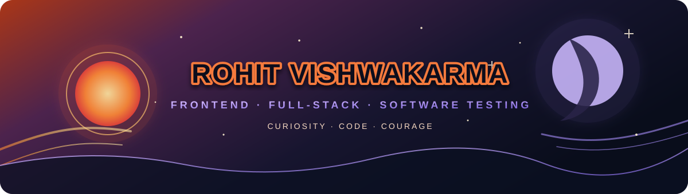

### Rohit Vishwakarma

**Computer Science Student · Frontend & Full-Stack Development · Software Testing**

[⚡ About](#about) · [📂 Projects](#project-archive) · [🧰 Toolkit](#toolkit) · [📈 GitHub](#github-stats) · [🤝 Connect](#connect)

---

## ⚡ About

Computer Science student with a good working knowledge of frontend and full-stack development, plus hands-on experience in manual and functional software testing. I enjoy building useful projects and thinking carefully about whether they work well for the people using them.

| 🔭 Current focus | 🧪 Quality mindset | 🎨 Design mood |
| --- | --- | --- |
| Frontend and full-stack projects | Test cases, bug reports, automation basics | Fire and shadow, inspired by *Naruto* and *The Eminence in Shadow* |

---

## 📂 Project archive

Pick a project to expand its overview. Each title also links to its GitHub repository.

🛡️ LinguaShield — multilingual scam investigation

A multimodal research prototype for examining suspicious messages, images, audio, and possible voice impersonation. Its investigation workflow brings together text, visual, acoustic, speaker-comparison, and copilot features, with English, Hindi, and Marathi supported in selected workflows.

**Stack:** Python · FastAPI · Browser frontend · ML/audio/OCR workflows

**Note:** LinguaShield supports investigation; it does not guarantee scam detection. Audio scores do not prove synthetic speech, and speaker similarity does not prove identity.

[Open LinguaShield →](https://github.com/ATOMIC7878/LinguaShield)

🏎️ CarGameProject-PC — AR/VR workshop project

A PC car game built as a project during an AR/VR workshop.

[Open CarGameProject-PC →](https://github.com/ATOMIC7878/CarGameProject-PC)

🦿 KneeNova — full-stack knee MRI app

A knee MRI workflow with study uploads, DICOM viewing, results, and reports.

**Stack:** React · JavaScript · Python · DICOM tools

[Open KneeNova →](https://github.com/ATOMIC7878/KneeNova)

🛰️ KesslerGrid — orbital traffic management

A space-traffic and collision-avoidance prototype combining orbital simulation with smart-contract concepts.

**Stack:** TypeScript · React · Ethereum / EVM

[Open KesslerGrid →](https://github.com/ATOMIC7878/KesslerGrid)

🌿 Smart Green Zone Guardian — IoT project

An IoT project focused on smart green zones. More implementation details will be added as the project documentation grows.

[Open Smart Green Zone Guardian →](https://github.com/ATOMIC7878/Smart-Green-Zone-Guardian)

🚦 Traffic Congestion Predictor — first-place hackathon project

A team prototype using machine learning and live APIs to predict traffic congestion. The project repository describes it as the team's first-place department-fest hackathon project.

**Focus:** Machine learning · Live APIs

[Open Traffic Congestion Predictor →](https://github.com/ATOMIC7878/Traffic-Congestion-Predictor)

🗃️ CodeVaultX Backend — backend API

Backend API for CodeVaultX.

**Language:** JavaScript

[Open CodeVaultX Backend →](https://github.com/ATOMIC7878/codevaultx-backend)

📚 OtakuVerse — notes-sharing platform

A premium notes-sharing platform built around the idea “Where Knowledge Meets Infinity.”

**Language:** HTML

[Open OtakuVerse →](https://github.com/ATOMIC7878/OtakuVerse)

---

## 🧰 Toolkit

**Frontend & full-stack:** Good working knowledge

**Programming languages and web:**

**Testing & tools:** Manual testing · Functional testing · Test case writing · Bug reporting · Selenium WebDriver · TestNG · JUnit · Postman · IntelliJ IDEA

---

## 📈 GitHub stats

---

## 🤝 Connect

Interested in software development, testing, or project collaboration? [Connect with me on LinkedIn](https://www.linkedin.com/in/rohit-vishwakarma-207476345/) or explore my [GitHub repositories](https://github.com/ATOMIC7878?tab=repositories).

*Thanks for visiting — choose a project above and open its panel to learn more.*

